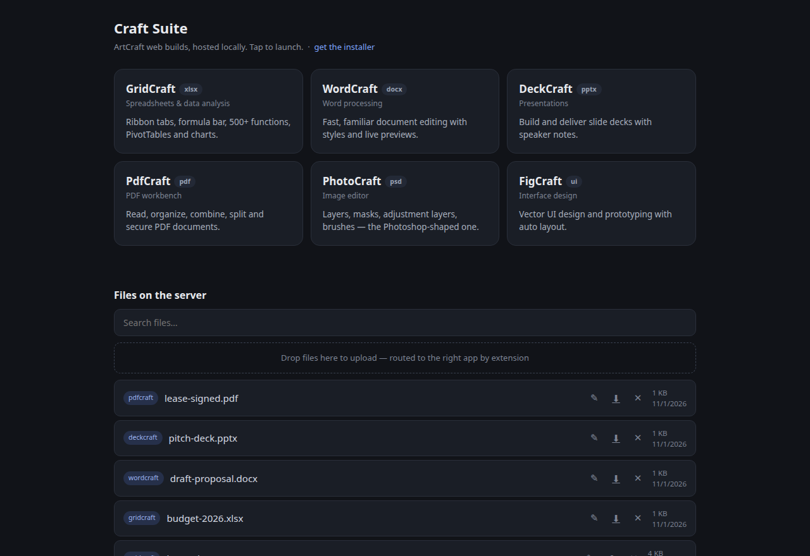
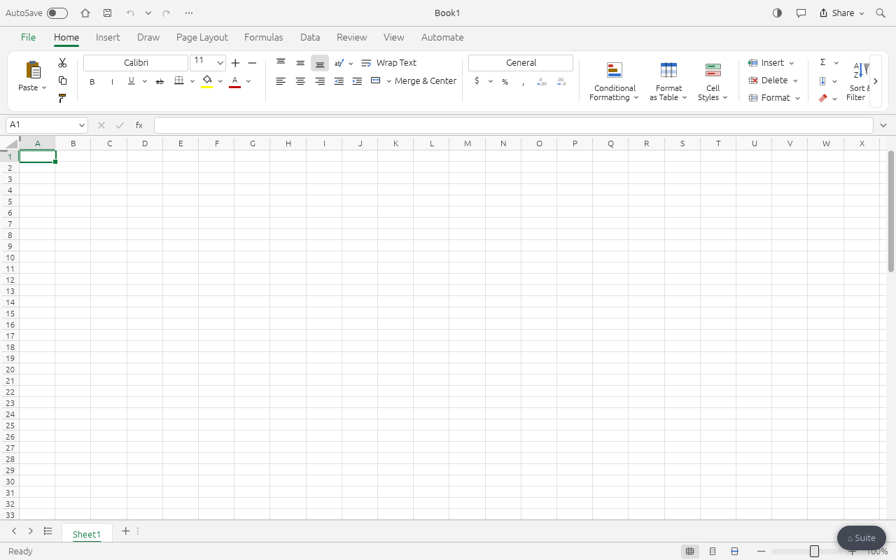
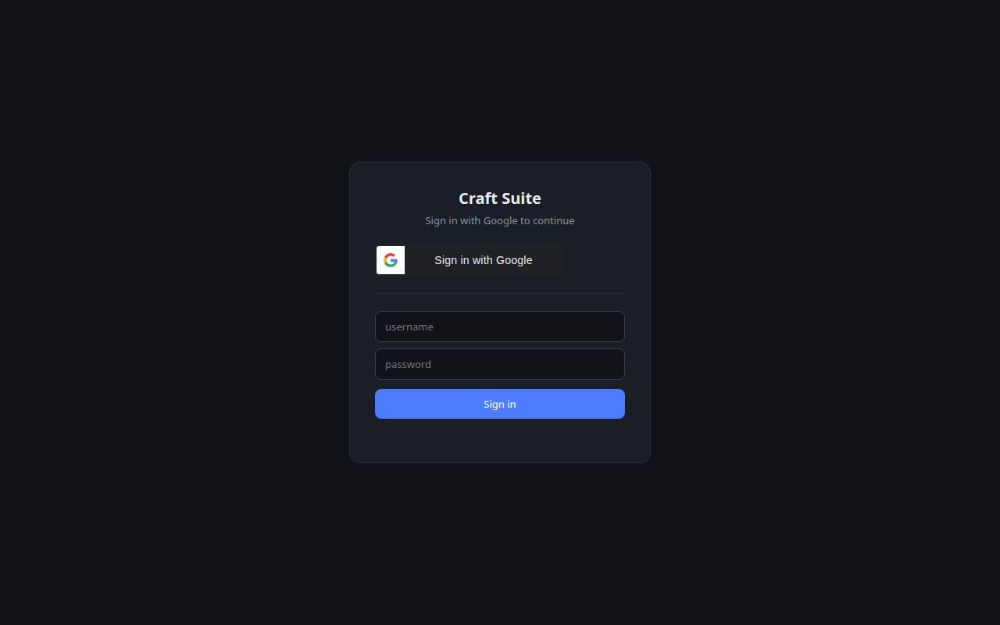

# Craft Suite

Self-hosted [ArtCraft](https://getartcraft.com/apps) web apps — the open-source,
subscription-free creative suite (spreadsheets, docs, slides, PDF, image
editing, UI design) — served on your LAN or the internet, **with real
server-side file storage, users, and SSO**.

The ArtCraft apps ship as WASM web builds that can only save via browser
downloads. Craft Suite wraps them with a small zero-dependency Node server
that gives every app proper open/save/rename/delete against server storage,
plus a launcher page, file browser, and a complete auth layer.

| Launcher + file browser | GridCraft running in the browser | Login wall (Google + local) |
|---|---|---|
|  |  |  |

## Features

- **Six apps, one server** — GridCraft, WordCraft, DeckCraft, PdfCraft,
  PhotoCraft, FigCraft, each mounted under its own path
- **Server-side storage** — Save/Save As/open/rename/delete all hit the
  server's `storage/` dir, transparently injected into each app
- **Save vs Save As semantics** — silent overwrite on matching name, filename
  dialog otherwise, with a "save a copy" escape hatch
- **Landing page** — app launcher + unified file browser with live search,
  drag-and-drop upload (routed to the right app by extension), deep-link
  file opening
- **Auth built in** — Google sign-in (ID-token flow) **and** local
  username/password accounts, session cookies, per-user storage
  (`storage/<app>/<user>/`), auth required for every client
- **User management** — admin role sees every user's files and can act on
  them; admin-only UI for adding Gmail + local users, role toggles, password
  resets, last-admin protection
- **Auto-update** — `update.js` pulls new web builds from GitHub releases,
  applies patches, injects the shim; daily systemd timer included
- **Single-file installer** — everything below embedded in one `.sh`

## Quickstart

```bash
curl -fsSL https://github.com/4fthawaiian/craft-suite/releases/latest/download/craft-suite-install.sh | sh
# or: sh craft-suite-install.sh
```

Requires `node` (18+) and `unzip`. Installs to `~/craft-suite`, downloads the
app builds, installs a systemd user service when available, prints the URL.

Config env vars: `CRAFT_SUITE_DIR`, `CRAFT_SUITE_PORT` (default 8091),
`CRAFT_SUITE_APPS` (subset to install), `INSTALL_SERVICE` (0 = skip systemd).

## Architecture

```
browser → nginx (TLS, optional) → serve.js :8091
            ├── static: app web builds + landing page + suite-shim.js
            └── /api/*: files (list/get/save/rename/delete), users, auth
```

`serve.js` is one file, no npm dependencies. `suite-shim.js` is injected into
each app's `index.html` and intercepts the WASM file dialogs (blob-download
saves, hidden file-input opens) to reroute them to `/api/*`.

## Auth & users

- `SUITE_AUTH=1` requires sign-in for **every** client — the bootstrapped
  `admin` local account works out of the box.
- **Google**: `GOOGLE_CLIENT_ID` env; sign-in verifies the ID token's `aud`.
  Allowlist lives in `users.json` (admin-managed) / `auth-emails.txt` (legacy).
- **Local accounts**: scrypt-hashed passwords; an `admin` account is created
  on first boot (password in `local-admin-password.txt` or
  `SUITE_ADMIN_PASSWORD` env).
- Roles: `admin` sees/acts on all users' files and manages users; `user` is
  scoped to their own storage dir.

## Production exposure

With `SUITE_AUTH=1` the storage API requires a session for every client —
the bootstrapped `admin` local account is your way in. Put it behind TLS
before exposing it beyond the LAN. `sso/` also has a ready-made
oauth2-proxy + Caddy bundle if you prefer that over the built-in auth
(it also enables per-user storage via `X-Forwarded-User`).

## Developing

```bash
node serve.js . 8091          # serve
node update.js                # update app builds (skips current)
node update.js --force        # re-download everything
sh build-installer.sh         # regenerate dist/craft-suite-install.sh
```

## Legal

ArtCraft app code is MIT/Apache-2.0 by its authors
([github.com/storytold](https://github.com/storytold)). The Craft names and
logos are ArtCraft trademarks.

Craft Suite glue code: MIT.
